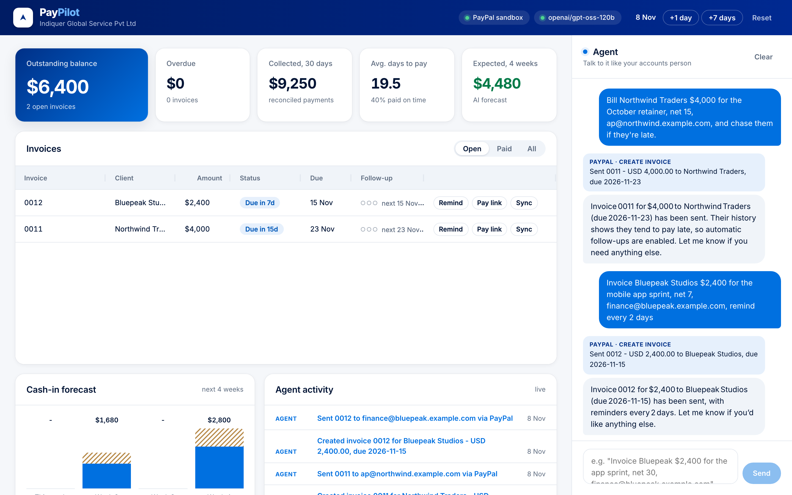
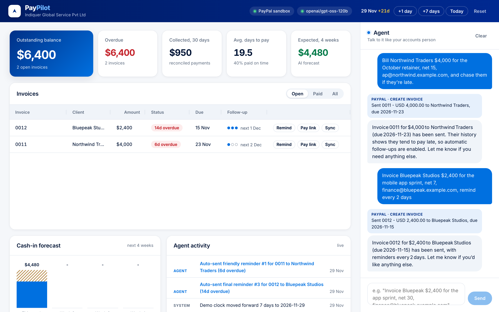
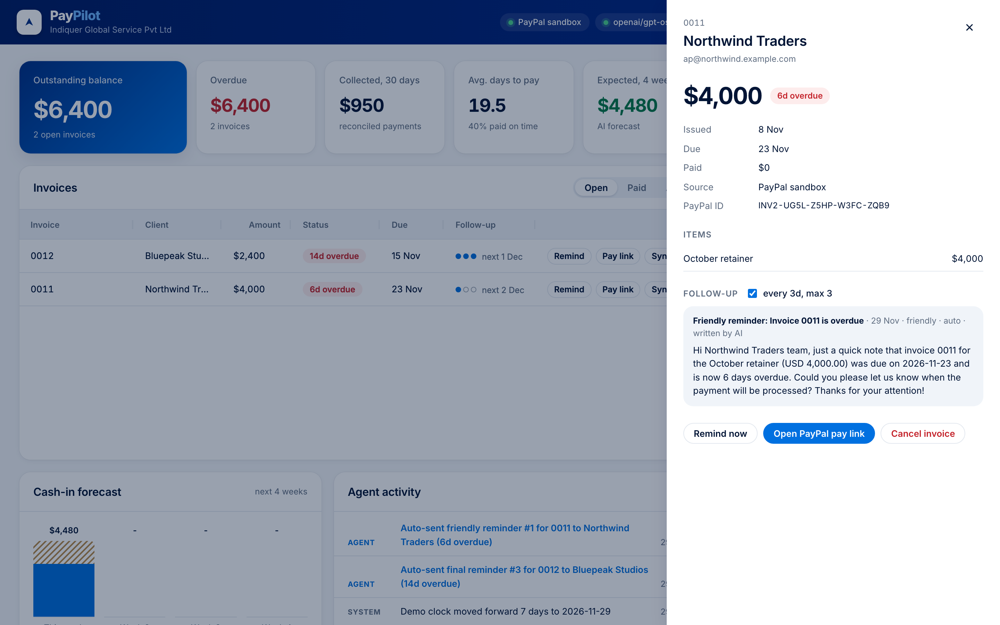
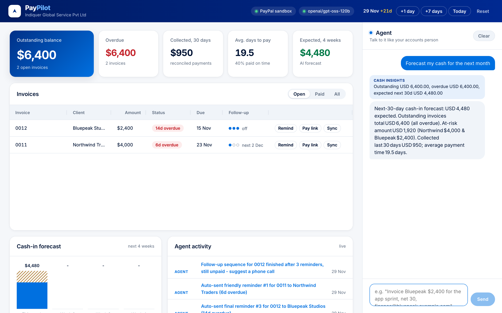
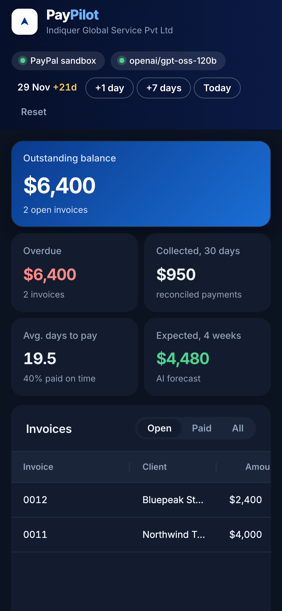

# PayPilot

**An AI accounts-receivable agent that invoices, chases and reconciles payments on PayPal.**
Built by Indiquer Global Service Pvt Ltd for the PayPal AI Hackathon 2026.

**Live demo: [paypilot.indiquer.in](https://paypilot.indiquer.in)** (PayPal sandbox, login required: ask the team for access) · [Demo script](docs/DEMO_SCRIPT.md)



Small businesses lose days every month on the same loop: write the invoice, send it, remember who hasn't paid, write an awkward reminder, check whether the money landed, match it to the invoice. PayPilot does that loop for you. You tell it in plain language who to bill; it creates and sends a real PayPal invoice, watches for the payment, writes and sends reminders that escalate in tone when the client is late, reconciles the payment the moment it lands, and forecasts what cash is coming in.

> "Bill Northwind $4,000 for the October retainer, net 15, ap@northwind.example.com, and chase them if they're late."

PayPilot creates the invoice in PayPal and sends it. It also notes that Northwind usually pays ~12 days late, and arms a follow-up sequence. Sixteen days later it sends a friendly reminder it wrote itself, then a firm one. When Northwind pays, a PayPal webhook arrives, PayPilot pulls the invoice from PayPal, matches the transaction, stops the reminders, and updates the forecast.

## Screenshots

| | |
|---|---|
|  |  |
| **Three weeks later.** The demo clock jumped ahead; both invoices are overdue and the agent has sent reminders on its own. | **A reminder the AI wrote** for Northwind, 6 days late, sent through PayPal's remind API. |
|  |  |
| **Cash forecast on request.** The agent calls its insights tool and answers in plain language. | **Works on a phone**, in light and dark mode. |

All screenshots use real PayPal sandbox invoices created by the agent; client emails are `example.com` addresses.

## What it does

| | |
|---|---|
| **Natural-language invoicing** | An LLM agent with tool calling turns a sentence into a PayPal invoice (client, line items, currency, terms) and sends it. It asks for missing essentials like the billing email instead of guessing. |
| **Autonomous follow-ups** | Per-invoice policy (cadence, maximum reminders). The scheduler sends reminders through PayPal's remind API. Each note is written by the AI for that client, amount and lateness, and escalates friendly → firm → final. After the last one it flags the invoice for a phone call. |
| **Reconciliation** | PayPal webhooks trigger a re-fetch of the invoice from the PayPal API. New transactions are matched to the invoice and classified as matched, partial, overpaid or unmatched (currency mismatch). Follow-ups stop automatically when an invoice is paid in full. Polling is a fallback when webhooks can't reach the server. |
| **Cash insights** | Outstanding, overdue, collected (30 days), average days to pay, on-time rate. Also a 4-week cash-in forecast that shifts each invoice by that client's historical lateness, and an at-risk list. |
| **Human in control** | Every agent action appears as a card in the chat and in the activity feed. Any invoice can be reminded, synced or cancelled by hand, and follow-ups can be switched off per invoice. |

## How PayPal and AI are used

**PayPal Developer Platform (Invoicing API v2, sandbox)**, in `server/src/paypal/live.ts`:
- `POST /v1/oauth2/token`: OAuth client-credentials auth, token cached until expiry
- `POST /v2/invoicing/generate-next-invoice-number`, `POST /v2/invoicing/invoices`: create invoices
- `POST /v2/invoicing/invoices/{id}/send`: deliver to the client with PayPal's hosted pay page
- `POST /v2/invoicing/invoices/{id}/remind`: AI-written reminders
- `GET /v2/invoicing/invoices/{id}`: source of truth for status and payment transactions
- `POST /v2/invoicing/invoices/{id}/cancel` / `DELETE`: cancel sent invoices / delete drafts
- **Webhooks** `INVOICING.INVOICE.*` → `POST /api/paypal/webhook`, with signature verification via `POST /v1/notifications/verify-webhook-signature`

**AI**, in `server/src/agent/`:
- **Agent with tool calling** (`agent.ts`, `tools.ts`): an OpenAI-compatible chat-completions model (Groq `openai/gpt-oss-120b` by default) with eight tools: `create_invoice`, `send_invoice`, `send_reminder`, `set_followup`, `cancel_invoice`, `get_invoice`, `list_invoices`, `cash_insights`. It runs a loop of up to 6 tool steps per request.
- **Reminder writer** (`writer.ts`): JSON-mode generation of each reminder's subject and body from the client, amount, days overdue, reminders already sent and tone.
- **Offline fallback** (`offline.ts`): a rule-based parser keeps the app usable with no API key and if the model is unavailable.

## Architecture

```
React (Vite) dashboard ── /api ──► Express (TypeScript)
  chat · AG Grid invoices            ├─ agent/      LLM tool-calling loop, reminder writer, offline parser
  KPIs · forecast · activity         ├─ services/   invoices · follow-up scheduler · reconciliation · insights
                                     ├─ paypal/     Invoicing v2 client (sandbox)  |  offline simulator
                                     └─ JSON store  invoices · payments · activity · chat
PayPal webhooks ──► /api/paypal/webhook ─► verify signature ─► re-fetch invoice ─► reconcile
```

Design choices worth noting:
- **Webhooks never carry amounts into the books.** A webhook only triggers a fetch from PayPal's API, so a forged or replayed event can't mark anything paid.
- **Demo clock.** The scheduler, insights and activity feed read time from a clock you can move forward (+1 day / +7 days in the header). This lets the demo show a 3-week collection cycle in a minute. Dates sent to PayPal always use real time.
- **Sample history** of paid invoices (clearly tagged `SAMPLE`, never sent to PayPal) gives the forecast and payment-behaviour features something to learn from. Every open invoice is created live.

## Run it

Requires Node 20+.

```bash
git clone <this repo> && cd paypilot
npm install
cp .env.example .env        # add keys (optional, see below)
npm run dev                 # API on :8787, app on http://localhost:5173
```

**With no keys** it runs end to end using the PayPal simulator and the offline parser. Use "Client pays" to act as the customer.

**With PayPal sandbox:**
1. At [developer.paypal.com](https://developer.paypal.com), open Apps & Credentials → Sandbox and create an app.
2. Put its Client ID and Secret in `.env`.
3. Invoices now appear in your sandbox business account. Pay them by opening the "Pay link" while logged in as a sandbox personal account.
4. For instant reconciliation, expose the server (for example on Render or with a tunnel) and add a webhook for `INVOICING.INVOICE.*` pointing at `https://<host>/api/paypal/webhook`. Then set `PAYPAL_WEBHOOK_ID`. Without a webhook, PayPilot polls open invoices every minute.

**With the AI agent:** set `LLM_API_KEY` (a [Groq](https://console.groq.com) key works with the defaults). Any OpenAI-compatible endpoint with tool calling works via `LLM_BASE_URL` and `LLM_MODEL`. Reasoning models such as `gpt-oss` are supported.

**Production build:** `npm run build && npm start` serves the app and API on one port. `render.yaml` deploys it to Render as-is.

**Putting it on the internet:** set `APP_USER` and `APP_PASSWORD` to require a login (HTTP Basic Auth). `/api/paypal/webhook` and `/api/health` stay open so PayPal can reach the server; webhooks are still signature-checked when `PAYPAL_WEBHOOK_ID` is set. The live demo runs this way under pm2 behind a Cloudflare Tunnel.

## Try these

- `Bill Northwind Traders $4,000 for the October retainer, net 15, ap@northwind.example.com`
- `Invoice Bluepeak Studios $2,400 for the mobile app sprint, net 7, finance@bluepeak.example.com, remind every 2 days`
- `What's overdue?` · `Forecast my cash for the next month` · `Send a firm reminder to Northwind` · `Turn off follow-ups for Bluepeak`

Then press **+7 days** a few times and watch the agent work through the activity feed.

## Notes and limits

- Built for the PayPal **sandbox**. Use USD (default) or another currency your sandbox business account supports for invoicing.
- Single-tenant demo storage (a JSON file). A production version would use a database and per-business auth.
- Sample client emails use `example.com` and are not deliverable.

## License

MIT, © 2026 Indiquer Global Service Private Limited.
